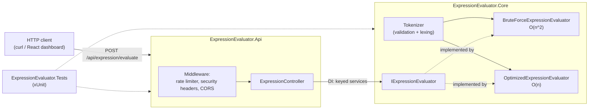

# Architecture — Architect agent notes

## Goals

- Calculation logic lives in the API (not a UI), and is hand-written (no
  third-party expression-evaluation library).
- Two algorithms available behind one interface, so callers (API, future
  dashboard) don't care which is running.
- Small, testable surface area given the scope of the exercise.

## Component diagram

## Request flow

1. Request hits `/api/expression/evaluate` (optimized, default),
   `/api/expression/evaluate/brute-force`, or `/api/expression/evaluate/compare`.
2. Rate limiting (60 req/min/IP) and security headers middleware run first.
3. `ExpressionController` validates the DTO (`[Required]`, length cap), then
   delegates to the requested `IExpressionEvaluator` implementation(s),
   resolved via keyed DI (`"bruteForce"` / `"optimized"`).
4. `Tokenizer.Tokenize` is the single validation boundary shared by both
   algorithms: expression length cap, character whitelist (`0-9 + - * /`),
   no leading zeros, no empty/operator-terminated input.
5. Malformed input or division-by-zero raises `ExpressionException`, mapped
   to HTTP 400 with a `ProblemDetails` body. Nothing else escapes as a 500
   for expected bad input.

## Why this split

- **Core has zero ASP.NET Core dependency** — it's a plain class library, so
  it can be unit tested without spinning up a host, and reused by a CLI or
  the dashboard's BFF later if needed.
- **Keyed DI, not a factory `enum`** — adding a third algorithm later means
  registering another keyed singleton and interface implementation; no
  switch statements to touch in the controller.
- **Validation centralized in `Tokenizer`** — both evaluators consume already
  validated tokens, so the security boundary (what characters/length are
  accepted) can't drift between the two implementations.

## Security considerations applied

| Concern | Mitigation |
|---|---|
| Injection / code execution | No `eval`, no `DataTable.Compute`, no dynamic code — a hand-rolled tokenizer with a strict character whitelist. |
| DoS via huge input | 1000-character expression cap enforced in `Tokenizer` before any parsing work. |
| DoS via request flooding | Fixed-window rate limiter, 60 requests/min per client IP. |
| Information disclosure | `ExpressionException` messages are safe, specific validation errors — no stack traces returned to clients. |
| CSRF / cross-origin abuse | CORS locked to an explicit allow-list (`AllowedOrigins` config), not `AllowAnyOrigin`. |
| Clickjacking / MIME sniffing | `X-Frame-Options: DENY`, `X-Content-Type-Options: nosniff` response headers. |
| Dependency supply chain | No new third-party packages added for calculation; only the ASP.NET Core/xUnit templates' default packages are used. |

## Deliberately out of scope for this pass

- Dashboard (React) and CI/CD pipeline — scoped as a fast-follow once the API
  is reviewed (see `CLAUDE.md`).
- Persistence/history of past evaluations — not required by the task.
