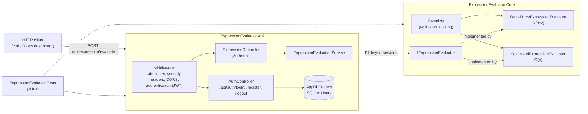

# Architecture — Architect agent notes

## Goals

- Calculation logic lives in the API (not a UI), and is hand-written (no
  third-party expression-evaluation library).
- Two algorithms available behind one interface, so callers (API, future
  dashboard) don't care which is running.
- Small, testable surface area given the scope of the exercise.

## Component diagram

## Request flow

1. `POST /api/auth/login` with username/password. `AuthService` verifies the
   BCrypt hash in `AppDbContext.Users` and, if valid, issues a signed JWT
   (HMAC-SHA256, `Jwt:Issuer`/`Jwt:Audience`/`Jwt:Key` from configuration).
   `POST /api/auth/register` creates a new user (role `"User"`, BCrypt
   hash) and returns a token the same way, or HTTP 409 if the username is
   already taken.
2. All `ExpressionController` endpoints (`/evaluate`, `/evaluate/brute-force`,
   `/evaluate/compare`, `/evaluate/trace`) require `[Authorize]` — a request
   without a valid `Authorization: Bearer <token>` header gets HTTP 401
   before it reaches the controller.
3. Rate limiting (60 req/min/IP), security headers, and CORS middleware run
   ahead of authentication/authorization.
4. `ExpressionController` validates the DTO (`[Required]`, length cap), then
   delegates to `ExpressionEvaluationService`, which resolves the requested
   `IExpressionEvaluator` implementation(s) via keyed DI (`"bruteForce"` /
   `"optimized"`).
5. `Tokenizer.Tokenize` is the single validation boundary shared by both
   algorithms: expression length cap, character whitelist (`0-9 + - * /`),
   no leading zeros, no empty/operator-terminated input.
6. Malformed input or division-by-zero raises `ExpressionException`, mapped
   to HTTP 400 with a `ProblemDetails` body. Nothing else escapes as a 500
   for expected bad input.

## Authentication & data store

- **Storage**: SQLite (`expressionevaluator.db`, local file, gitignored —
  never committed) via EF Core (`AppDbContext`, single `Users` table:
  `Id`, `Username` (unique), `PasswordHash` (BCrypt), `Role`, `CreatedAtUtc`).
  Chosen so the app runs with zero external services for local dev/review;
  see `docs/DEPLOYMENT.md` for the Supabase Postgres swap.
- **Seeding**: on first run, if `Users` is empty, one `admin` user is created.
  If `Seed:AdminPassword` is configured it is used and never logged. If not,
  in Development only, a random password is generated and logged once to the
  local console. In any hosted environment without it, no admin is seeded —
  so no password ever lands in a host's log stream — and users self-register.
- **Tokens**: stateless JWTs, 60-minute expiry. `/api/auth/logout` is a
  convenience endpoint only (confirms the token is still valid) — there is
  no server-side revocation list; the client is responsible for discarding
  the token. Acceptable for this scope; a production version would add a
  token blacklist or short-lived refresh tokens.
- **Signing key**: read from `Jwt:Key` (environment variable / secret
  store), never committed. In `Development` only, if unset, a random key is
  generated per process start — the app refuses to start without one
  outside Development.

## Why this split

- **Core has zero ASP.NET Core dependency** — it's a plain class library, so
  it can be unit tested without spinning up a host, and reused by a CLI or
  the dashboard's BFF later if needed.
- **Keyed DI, not a factory `enum`** — adding a third algorithm later means
  registering another keyed singleton and interface implementation; no
  switch statements to touch in the controller.
- **Validation centralized in `Tokenizer`** — both evaluators consume already
  validated tokens, so the security boundary (what characters/length are
  accepted) can't drift between the two implementations.

## Security considerations applied

| Concern | Mitigation |
|---|---|
| Injection / code execution | No `eval`, no `DataTable.Compute`, no dynamic code — a hand-rolled tokenizer with a strict character whitelist. |
| DoS via huge input | 1000-character expression cap enforced in `Tokenizer` before any parsing work. |
| DoS via request flooding | Fixed-window rate limiter, 60 requests/min per client IP. |
| Information disclosure | `ExpressionException` messages are safe, specific validation errors — no stack traces returned to clients. |
| CSRF / cross-origin abuse | CORS allows only configured origins: exact `AllowedOrigins`, plus optional `AllowedOriginPatterns` (one `*` inside a label that also has fixed text, followed by at least two fixed labels — anything wider fails startup). Never `AllowAnyOrigin`. |
| Clickjacking / MIME sniffing | `X-Frame-Options: DENY`, `X-Content-Type-Options: nosniff` response headers. |
| Dependency supply chain | Calculation logic uses no third-party packages; auth/DB packages (EF Core SQLite, JWT Bearer, BCrypt.Net-Next) were approved explicitly before adding, per this repo's policy. A transitive `SQLitePCLRaw` CVE (NU1903) was caught during install and pinned to a patched version. |
| Password storage | Never plaintext — BCrypt hash only, stored in SQLite. |
| Endpoint-level access control | Every `ExpressionController` route requires a valid JWT (`[Authorize]`); only `/api/auth/login` and `/api/auth/register` are anonymous. |
| Secret management | JWT signing key and real DB connection strings are configuration (env vars/secret store), never committed; the local SQLite file is gitignored. |

## Deliberately out of scope for this pass

- Deployment (Vercel/Render/Supabase) — plan documented in
  `docs/DEPLOYMENT.md`, not yet executed; awaiting hosting account setup.
- Token revocation / refresh tokens — logout is client-side only (see above).
- User management UI (promote/demote role, delete user, reset password) —
  registration exists (`/api/auth/register`), management does not; today
  that means editing the `Users` table directly.
